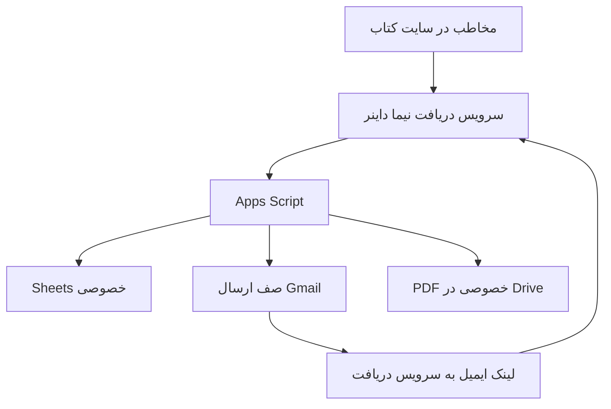

# معماری و دلیل انتخاب‌ها

## مسیر درخواست

1. فرم GitHub Pages یک POST معمولی به `/register` سرویس دریافت می‌زند. Worker فقط فیلدهای مجاز را منتقل می‌کند؛ محدودیت بدنه ۱۵۰۰۰ است.
2. Worker در سرور با POST و `action=api_register` به Apps Script متصل می‌شود؛ کاربر صفحهٔ گوگل نمی‌بیند.
3. رکورد `pending` و پیام تأیید و اعلان مالک در Sheets/Queue ذخیره می‌شود. ایمیل تابع صف و سهمیه است.
4. لینک ایمیل روی دامنهٔ سرویس دریافت است؛ `action` و توکن در fragment بعد از `#` قرار می‌گیرند، نه query اولیهٔ HTTP. صفحه هیچ ابزار تحلیل ثالث ندارد و `Referrer-Policy: no-referrer` دارد.
5. بازکردن لینک GET ایمیل را تأیید نمی‌کند. مخاطب دکمه را می‌زند؛ مرورگر POST به `/api/confirm` و Worker POST به `api_confirm` می‌فرستد.
6. Apps Script با کنترل توکن و انقضا، رکورد را `confirmed` می‌کند و توکن دریافت را تولید می‌کند. لینک دریافت هم در پاسخ و هم در ایمیل ارائه می‌شود.
7. POST به `/api/download` به `api_download` و سپس `requestFile` می‌رسد. PDF خصوصی در Apps Script به base64 تبدیل می‌شود؛ Worker آن را به بایت PDF با `Content-Disposition: attachment` و `Cache-Control: no-store` تبدیل می‌کند. مرورگر Blob دریافت می‌کند و ذخیره را شروع می‌کند.

## رابط‌ها

| رابط Worker | روش | ورودی | خروجی |
|---|---|---|---|
| `/` | GET | fragment شامل action و token | صفحهٔ فارسی |
| `/health` | GET | ندارد | JSON سلامت سطحی؛ سلامت Google را ثابت نمی‌کند |
| `/register` | POST | فرم URL-encoded | صفحهٔ نتیجهٔ ثبت |
| `/api/confirm` | POST | JSON با token | JSON با توکن دریافت یا پیام تأیید قبلی |
| `/api/download` | POST | JSON با token | PDF؛ در خطا JSON و وضعیت خطا |

پشت Worker، `api_register`, `api_confirm`, `api_download` پاسخ JSON از ContentService دارند. مسیرهای قدیمی `doGet/doPost` برای لینک‌های قبلی هنوز موجودند. URL گوگل در کد سرور مخفی امنیتی محسوب نمی‌شود؛ امنیت دریافت به توکن و کنترل سمت سرور وابسته است.

## توکن‌ها و حدود

توکن ۶۴ کاراکتر hex از دو UUID ساخته می‌شود؛ SHA-256 آن در Subscribers نگهداری می‌شود. متن لینک در HTML صف خصوصی هم وجود دارد، بنابراین Queue به اندازهٔ دادهٔ مخاطبان حساس است. تأیید ۷ روز، دریافت ۹۰ روز و سقف دریافت ۳۰ درخواست است. ثبت‌نام جدید حداکثر ۶۰ مورد در روز UTC است. تاریخ‌ها ISO/UTC هستند، حتی اگر نمایش Sheets منطقهٔ تهران باشد.

قفل ScriptLock از هم‌زمانی در ویرایش جلوگیری می‌کند؛ Sheets یک پایگاه دادهٔ تراکنشی کامل نیست. امکان شکست میان ذخیرهٔ وضعیت و enqueue وجود دارد و نیازمند رسیدگی است.

## تصمیم‌های ثبت‌شده

- GitHub Pages برای صفحهٔ سبک و مستقل از build حفظ شد.
- Gmail مطابق ترجیح مالک برای ارسال حفظ شد؛ دامنهٔ ایمیل سفارشی الزامی نیست.
- مسیر مستقیم Google Apps Script در اندروید/چندحسابی برای بعضی کاربران خطای Drive داشت. Worker ارتباط گوگل را به سرور منتقل می‌کند. تست با حساب مالک به‌تنهایی کافی نیست.
- FormSubmit مسیر قدیمی است و دیگر فعال نیست. download.html فایل عمومی نمی‌دهد.
- این ساختار کنترل تحویل بر مبنای ایمیل است؛ DRM یا جلوگیری از بازنشر PDF نیست.
