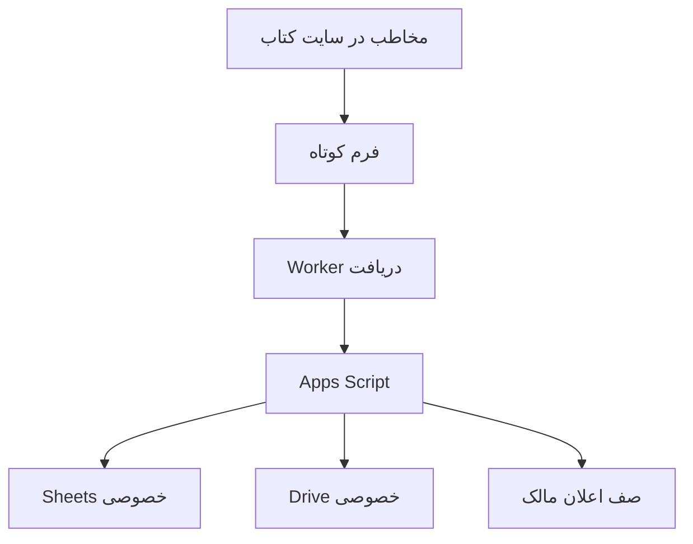

# معماری و دلیل انتخاب‌ها

## مسیر درخواست

1. فرم GitHub Pages فقط نام، ایمیل و تلفن اختیاری را به صورت POST به `/register` می‌فرستد؛ Worker فقط فیلدهای مجاز را منتقل می‌کند.
2. Worker در سرور با `action=api_register` به Apps Script وصل می‌شود. Apps Script رکورد را در Sheets خصوصی ثبت می‌کند، وضعیت تازه را `registered` می‌گذارد و توکن دانلود ۹۰روزه می‌سازد؛ آدرس ایمیل تأیید نمی‌شود.
3. Worker با همان توکن فایل خصوصی Drive را از Apps Script می‌گیرد و پاسخ فرم را مستقیماً به PDF با `Content-Disposition: attachment` تبدیل می‌کند؛ مرورگر دانلود را آغاز می‌کند.
4. اگر دریافت فایل در درخواست اول آماده نشود، صفحهٔ جایگزین لینک و دکمهٔ تلاش دوباره را نشان می‌دهد. ایمیل تأیید یا پیدا کردن ایمیل دوم لازم نیست.
5. درخواست فایل در Apps Script ثبت می‌شود. این شمارنده آماده‌سازی فایل را نشان می‌دهد، نه ذخیرهٔ قطعی روی دستگاه. اعلان ثبت تازه برای مالک جداگانه در صف Gmail می‌ماند.
6. مسیرهای `api_confirm` و `action=confirm` برای لینک‌های قدیمی نگهداری می‌شوند؛ ثبت‌نام جدید از آن‌ها استفاده نمی‌کند.

## رابط‌ها

| رابط Worker | روش | ورودی | خروجی |
|---|---|---|---|
| `/` | GET | fragment شامل action و token | صفحهٔ فارسی |
| `/health` | GET | ندارد | JSON سلامت سطحی؛ سلامت Google را ثابت نمی‌کند |
| `/register` | POST | فرم URL-encoded | PDF مستقیم؛ در خطای آماده‌سازی صفحهٔ جایگزین |
| `/api/confirm` | POST | JSON با token | JSON برای لینک‌های قدیمی تأیید |
| `/api/download` | POST | JSON با token | PDF؛ در خطا JSON و وضعیت خطا |

پشت Worker، `api_register`, `api_confirm`, `api_download` پاسخ JSON از ContentService دارند. مسیرهای قدیمی `doGet/doPost` برای لینک‌های قبلی هنوز موجودند. URL گوگل در کد سرور مخفی امنیتی محسوب نمی‌شود؛ امنیت دریافت به توکن و کنترل سمت سرور وابسته است.

## توکن‌ها و حدود

توکن ۶۴ کاراکتر hex از دو UUID ساخته می‌شود؛ SHA-256 آن در Subscribers نگهداری می‌شود. متن لینک در HTML صف خصوصی هم وجود دارد، بنابراین Queue به اندازهٔ دادهٔ مخاطبان حساس است. لینک‌های قدیمی تأیید ۷ روز اعتبار دارند؛ لینک دریافت ۹۰ روز و سقف هر شناسه ۳۰ درخواست است. ثبت‌نام جدید حداکثر ۶۰ مورد در روز UTC است. تاریخ‌ها ISO/UTC هستند، حتی اگر نمایش Sheets منطقهٔ تهران باشد.

قفل ScriptLock از هم‌زمانی در ویرایش جلوگیری می‌کند؛ Sheets یک پایگاه دادهٔ تراکنشی کامل نیست. امکان شکست میان ذخیرهٔ وضعیت و enqueue وجود دارد و نیازمند رسیدگی است.

## تصمیم‌های ثبت‌شده

- GitHub Pages برای صفحهٔ سبک و مستقل از build حفظ شد.
- Gmail مطابق ترجیح مالک برای ارسال حفظ شد؛ دامنهٔ ایمیل سفارشی الزامی نیست.
- مسیر مستقیم Google Apps Script در اندروید/چندحسابی برای بعضی کاربران خطای Drive داشت. Worker ارتباط گوگل را به سرور منتقل می‌کند. تست با حساب مالک به‌تنهایی کافی نیست.
- FormSubmit مسیر قدیمی است و دیگر فعال نیست. download.html فایل عمومی نمی‌دهد.
- این ساختار کنترل تحویل بر مبنای ایمیل است؛ DRM یا جلوگیری از بازنشر PDF نیست.
